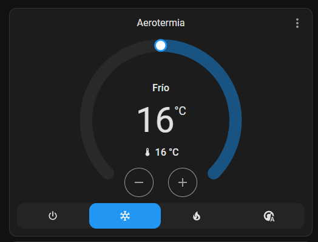

# Aerothermal Temperature Control

Tarjeta Lovelace personalizada para Home Assistant que controla una instalación de
**aerotermia con suelo radiante y depósito de inercia**:

- Termostato del **suelo radiante** (enciende/apaga la bomba de impulsión vía relé) con presets.
- Bloque del **motor LG** (objetivo de agua + temperatura de impulsión / inercia).
- **Modo único compartido** (off / frío / calor / auto) que sincroniza el termostato y el motor.
- **Modos automáticos**: en calor, eco de noche y confort a tiempo para la hora que elijas;
  con el **modo vacaciones**, away en calor y en frío y la casa lista para la vuelta. Con
  candado para bloquearlos.

La inteligencia (conmutación calor/frío, presets, modos automáticos, seguridad) vive en el
**servidor** (HA), no en la tarjeta, así funciona aunque no haya ninguna pestaña abierta.

## Qué muestra la tarjeta

- **Apagada:** una sola fila con el nombre, «Apagado» y la temperatura de la casa, y la barra
  de modos para encenderla.
- **Encendida:** el dial del termostato activo, el **candado** de los modos automáticos arriba
  a la derecha y, debajo, una **línea plegable** con el objetivo de agua y la impulsión, más los
  iconos del motor, la bomba, los modos automáticos y el preset puesto. Al tocarla se despliega:
  objetivo de agua (+/−), impulsión, bomba, **presets** y, en calor y en frío, el interruptor
  de **modos automáticos**. Abajo, la barra de modos (off / frío / calor / auto).
- **Ajustar la temperatura con un preset marcado** la guarda como temperatura de ese preset y
  el preset sigue marcado (necesita usuario administrador; si no, es un cambio normal y el preset
  pasa a `none`).

**[▶ Probar la demo](https://serweck.github.io/aerothermal-temperature-control/)**: la tarjeta real sobre una
casa simulada, en el navegador y sin Home Assistant. Puedes cambiar de modo, desplegar el
motor, tocar presets y candado, y ver en un registro qué órdenes mandaría a HA. Se publica sola
en GitHub Pages con cada cambio en `main` (`.github/workflows/demo.yml`).



---

## Arquitectura

```
                 ┌───────────────────────────┐
                 │  Tarjeta Lovelace (esta)   │  solo UI: lee estados / llama servicios
                 └─────────────┬─────────────┘
                               │
   input_select.aerotermia_modo (off / calor / frio / auto)   <- modo maestro
                               │
        ┌──────────────────────┴───────────────────────┐
        │ Automatización A: conmuta modo + sincroniza   │
        └───────┬───────────────────────┬──────────────┘
                │                        │
   climate.suelo_radiante_calor   climate.suelo_radiante_frio   (generic_thermostat)
        (ac_mode off)                 (ac_mode true)
                └───────────┬───────────┘
                            ▼
        switch.socket_garaje_aerotermia_bomba   (relé bomba de impulsión)
                            ▲
   sensor.temperatura_termostato  (sensor de la zona)

   climate.bomba_de_calor_aire_agua_2  (motor LG: objetivo agua + impulsión real)
```

Los dos `generic_thermostat` comparten relé y sensor; solo uno está activo a la vez
(el otro queda en `off`). En `auto` decide el motor LG: los dos termostatos quedan en `off` y
el suelo circula de forma continua con cortes de seguridad (automatización D).

### Modos automáticos

Solo cambian el **preset** del termostato activo, y nunca con el candado puesto
(`input_boolean.bloquear_termostato`). En auto y off no hacen nada.

- **E · Modos automáticos (calor):** eco desde `input_datetime.aerotermia_hora_eco` (23:00) y
  comfort desde el arranque que calcula `binary_sensor.aerotermia_arranque_confort`, para tener
  la casa a la temperatura de confort a `input_datetime.aerotermia_hora_confort` (08:30).
- **F · Aprender ritmo de calentamiento:** mide cada subida de eco a comfort y ajusta
  `input_number.aerotermia_ritmo_calentamiento` (°C/h), que usa el cálculo del arranque.
- **G · Recordar temperatura de confort:** copia la temperatura del preset comfort a un
  `input_number`, porque una plantilla no puede leer la de un preset.
- **H · Vacaciones:** con `input_boolean.modo_vacaciones`, el termostato de calor o de frío
  pasa a away. Con vuelta programada vuelve a comfort con antelación
  (`binary_sensor.aerotermia_vuelta_vacaciones`): en calor, lo que tarde en subir con el ritmo
  aprendido (máx. 24 h); en frío, `input_number.aerotermia_antelacion_vuelta_frio` (48 h). Al
  terminar el modo, en frío vuelve a comfort y en calor E aplica el horario. Mientras dura, E no
  actúa.

E, F y H se encienden y apagan juntas desde el interruptor de la tarjeta. Los helpers son de la
interfaz de HA; están documentados en [`ha-config/configuration.yaml`](ha-config/configuration.yaml).

---

## Instalación

### 1. Backend (Home Assistant)

Copia el contenido de [`ha-config/configuration.yaml`](ha-config/configuration.yaml) a tu
`configuration.yaml` y el de [`ha-config/automations.yaml`](ha-config/automations.yaml) a tus
automatizaciones. Reinicia Home Assistant.

Verifica que existan: `climate.suelo_radiante_calor`, `climate.suelo_radiante_frio` e
`input_select.aerotermia_modo`.

En la instalación real los dos termostatos, los helpers de los modos automáticos y el sensor
del arranque se crearon desde la interfaz (Ajustes → Ayudantes); el YAML de `ha-config/` los
documenta. Si los creas desde YAML, no los crees también desde la interfaz.

### 2. La tarjeta

**Opción A — HACS (repositorio personalizado):**

1. HACS → ⋮ → *Repositorios personalizados*.
2. URL: `https://github.com/serweck/aerothermal-temperature-control` · Categoría: **Dashboard**.
3. Instálalo desde HACS. El recurso Lovelace se registra solo; recarga el navegador (Ctrl+F5).

**Opción B — Manual:**

1. Copia `dist/aerothermal-temperature-control.js` a `config/www/` de tu HA
   (p. ej. `config/www/aerothermal-temperature-control.js`).
2. Añádelo como recurso (Ajustes → Paneles → ⋮ → Recursos, o en YAML):

   ```yaml
   resources:
     - url: /local/aerothermal-temperature-control.js
       type: module
   ```
3. Recarga el navegador (Ctrl+F5).

### 3. Añadir la tarjeta a un dashboard

```yaml
type: custom:aerothermal-temperature-control
name: Aerotermia
mode_select: input_select.aerotermia_modo
thermostat_heat: climate.suelo_radiante_calor
thermostat_cool: climate.suelo_radiante_frio
water_climate: climate.bomba_de_calor_aire_agua_2
current_sensor: sensor.temperatura_termostato   # temp real del dial (recomendado)
pump_switch: switch.socket_garaje_aerotermia_bomba
inertia_sensor: ""        # vacío -> usa current_temperature del LG
lock_entity: input_boolean.bloquear_termostato  # candado de los modos automáticos
auto_mode_automations:    # interruptor en el desplegable del motor (calor y frío)
  - automation.aerotermia_modos_automaticos_calor
  - automation.aerotermia_aprender_ritmo_de_calentamiento
  - automation.aerotermia_vacaciones
presets:
  - { label: Fuera,   preset: away,    icon: "mdi:home-export-outline" }
  - { label: Confort, preset: comfort, icon: "mdi:sofa" }
  - { label: Eco,     preset: eco,     icon: "mdi:leaf" }
show_modes: [off, cool, heat, auto]
```

También hay **editor visual** para los entity_id principales (presets y `show_modes` se editan en YAML).

---

## Opciones de configuración

| Opción | Req. | Descripción |
|--------|:---:|-------------|
| `mode_select` | ✅ | `input_select` del modo maestro (off/calor/frio). |
| `thermostat_heat` | ✅ | `generic_thermostat` de calor. |
| `thermostat_cool` | ✅ | `generic_thermostat` de frío. |
| `water_climate` | ✅ | Climate del motor LG. |
| `current_sensor` | — | Sensor de la zona para la temperatura real del dial. Recomendado: más fiable que el `current_temperature` del termostato (que puede no refrescar). |
| `pump_switch` | — | Relé de la bomba (indicador). |
| `inertia_sensor` | — | Sensor de inercia; vacío usa `current_temperature` del LG. |
| `lock_entity` | — | `input_boolean` que bloquea los modos automáticos; se muestra como candado arriba a la derecha. |
| `auto_mode_automations` | — | Automatizaciones de los modos automáticos. En calor y en frío, el desplegable del motor muestra un interruptor que las enciende o apaga todas a la vez. |
| `name` | — | Título de la tarjeta. |
| `presets` | — | Lista `{label, preset[, icon]}`, en el desplegable del motor. Por defecto Fuera/Confort/Eco/En Casa/Dormir; solo se muestran los que el termostato activo tiene en `preset_modes`. El icono también marca el preset puesto en la línea plegada. |
| `show_modes` | — | Subconjunto de `off`, `cool`, `heat`, `auto`. |

---

## Desarrollo

```bash
npm install      # dependencias
npm run build    # genera dist/aerothermal-temperature-control.js
npm run watch    # recompila al guardar
npm run typecheck
npm run demo     # build + demo en _site/index.html (la misma que publica GitHub Pages)
```

Código en `src/` (LitElement + TypeScript). El editor visual está en `src/editor.ts`.

---

## Notas

- La temperatura de cada preset vive en las opciones del `generic_thermostat`. Se cambia desde
  la tarjeta (ajustando con el preset marcado) o en Ajustes → Ayudantes → el termostato →
  Opciones. No hace falta reiniciar: el termostato se recarga y conserva su preset.
- Suelo radiante en frío: vigila la **condensación** (la temperatura de impulsión del agua,
  que fija el LG, no debe bajar del punto de rocío).
- `min_cycle_duration: 10 min` protege la bomba de ciclos cortos.

## Licencia

MIT
